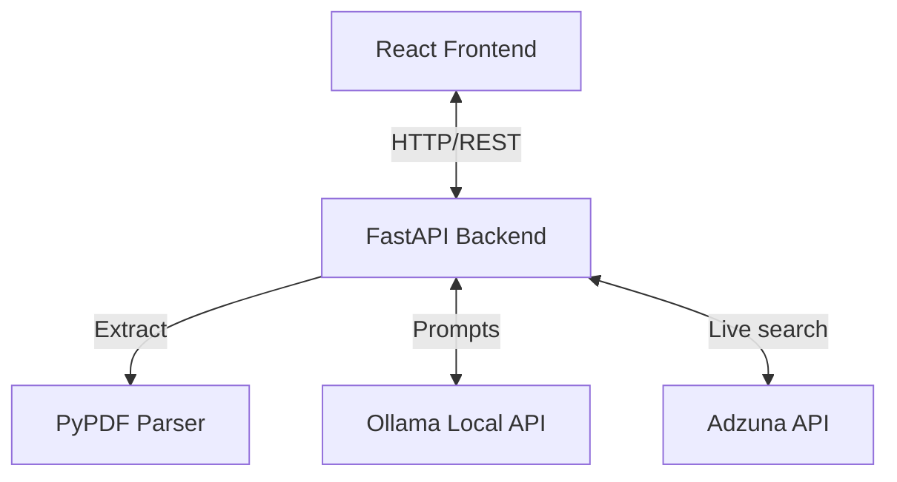

# AI-Based Resume Analysis, Skill Gap Detection and Job Recommendation System

## 1. Problem Statement
Job seekers often struggle to align their current skills with market demands resulting in a mismatch between candidate capabilities and employer requirements. Furthermore, manually parsing job descriptions to find gaps is time-consuming and inefficient.

## 2. Objectives
- Automate resume data extraction seamlessly.
- Provide a clear visualization of existing candidate skills and identified missing skills relative to their targeted roles using AI.
- Correlate candidate data perfectly with real-time job market integration (Adzuna).
- Provide deterministic matching calculations for career suggestions.
- Equip the user with an AI assistant for tailored career guidance.

## 3. Features
1. **Dynamic Resume Parsing:** Direct uploads extraction via PyPDF and logical mapping using Ollama LLM.
2. **AI Actionable Skill Gaps:** Detects existing and missing skills dynamically using an intelligent Prompt logic.
3. **Live Adzuna Job Search:** Retrieves real-world opportunities from `api.adzuna.com` instead of mock local databases.
4. **Deterministic Match Algorithm:** Evaluates matched vs missed skills and transparently shares the % match.
5. **Interactive AI Assistant:** Uses your resume context explicitly to field prompts about careers.

## 4. Technology Stack
- **Frontend**: React.js, Vite, Axios, React Router, Vanilla CSS
- **Backend**: Python 3, FastAPI, Uvicorn, Request handling, PyPDF
- **External Services**: Local/Remote Ollama (LLM API), Adzuna (Job API)

## 5. System Architecture


### Distinction of System Components:
- **AI-generated analysis:** The structured extraction of personal info, soft skills, technical skills, and gap recommendations generated inherently by the Ollama context window.
- **API-provided job data:** Real opportunities provided neutrally and accurately by Adzuna without AI hallucination.
- **Backend-calculated match percentage:** Python code in `job_matching_service.py` safely computing differences between AI-extracted job requirements and user skills, ensuring explainability.

## 6. Installation & Environment Configuration
### Prerequisites
- Node.js (18+), Python (3.10+)

### Setting up the Backend
1. `cd backend`
2. `python -m venv venv`
3. Activate: 
   - Windows: `venv\Scripts\activate` 
   - Mac/Linux: `source venv/bin/activate`
4. `pip install -r requirements.txt`
5. Create `.env` based on `.env.example`:
   ```env
   OLLAMA_API_KEY=
   OLLAMA_BASE_URL=http://localhost:11434
   OLLAMA_MODEL=llama3

   ADZUNA_APP_ID=your_id
   ADZUNA_APP_KEY=your_key
   ```
6. Start: `uvicorn app.main:app --reload` (Runs on `localhost:8000`)

### Setting up the Frontend
1. `cd frontend`
2. `npm install`
3. Start: `npm run dev` (Runs on `localhost:5173`)

## 7. API Endpoints
- `GET /api/health`: Validates the server connection.
- `POST /api/resume/upload`: Accepts `file` formData of a PDF and returns LLM-cleaned entity structures.
- `POST /api/skills/gap`: Accepts `resumeSkills` and `targetRole` strings. Returns deterministic lists of gaps.
- `GET /api/jobs`: Gets jobs directly mapping to mapped Adzuna outputs. Params: `keyword` & `location`.
- `POST /api/jobs/recommend`: Correlates top Adzuna jobs with `resumeSkills` to return percentages.
- `POST /api/ai/chat`: Interactive chat accepting `prompt` alongside `resume` data optionally.

## 8. Example Prompts
- "What skills am I missing for a Java backend developer?"
- "How can I improve my resume based on my current bullet points?"
- "What are the most popular frameworks I should add to my tech stack right now?"

## 9. Testing & Demonstration
To demonstrate this MVP:
1. Open up the React application at `localhost:5173`.
2. Drag and drop any software resume (PDF).
3. The platform will parse the PDF in FastAPI and send prompt text to Ollama.
4. Click **View Full Analysis** to view AI-determined roles and data.
5. Search a target role in `Detect Gaps` to see AI suggestions.
6. Check `Jobs` view and select `Recommend & Match` to verify the deterministic algorithm running against real-life Adzuna listings.

## 10. Limitations & Future Scope
### Limitations:
- The backend parses jobs for recommendations linearly. Fetching too many concurrently expands processing time. 
- Ollama accuracy is bound to model selections. Hallucinations might exist in the suggestions array.

### Future Scope:
- Integration of a relational DB for historical tracking.
- Parallel asyncio LLM queries to calculate matches for larger job query arrays.
